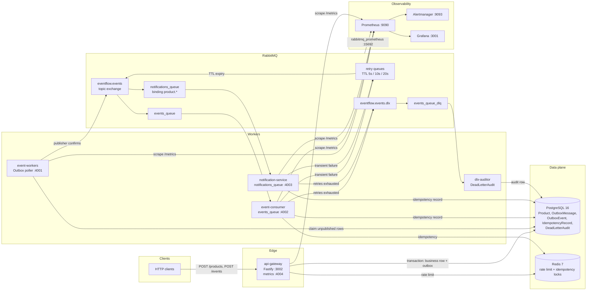

# EventFlow Engine

## Title & Executive Summary

EventFlow Engine is a TypeScript event-driven platform for production workloads that must accept writes under concurrency, survive broker or consumer failures, and keep a reliable audit of every domain event. An HTTP command commits the business row and its outbound event in one PostgreSQL transaction. A dedicated poller then publishes that event to RabbitMQ with publisher confirms. Independent consumers process the stream at least once, ignore duplicates, retry transient failures, and park poison messages on a dead-letter queue.

The gateway stays on the critical path only for the database commit. Downstream notification, audit, and integration work happens off the request. That split is what keeps ingestion latency stable when consumers slow down, and what prevents a lost event when RabbitMQ is unavailable at the moment of the write.

## Key Architectural Highlights

- **Write path under concurrency.** `POST /products` persists the product and an `OutboxMessage` in a single Prisma transaction. The HTTP response is returned after commit, so a broker outage cannot drop an event that the client was told succeeded.
- **Decoupled throughput.** The outbox poller, the `events_queue` consumer, the notification consumer, and the DLX auditor are separate processes. Each can be scaled without scaling the gateway. Notification delivery uses its own queue and a `product.*` binding, so it receives a copy of the event instead of competing with the primary consumer.
- **Bounded failure.** Recoverable consumer errors are republished to TTL retry queues at 5s, 10s, and 20s, then returned to the topic exchange. After the retry budget, the message is published to `eventflow.events.dlx` / `events_queue_dlq` and acknowledged only after that publish is confirmed. The DLX auditor stores the payload, headers, routing key, and attempt count in `DeadLetterAudit` for replay.
- **Duplicate safety.** Delivery is at-least-once. Consumers claim an idempotency key in Redis with `SET NX` and a TTL, and fall back to a PostgreSQL `IdempotencyRecord` when Redis is unavailable. A redelivered message is acknowledged and skipped.
- **Backpressure and protection.** Redis backs a distributed rate limit on the gateway (default 100 requests / 60s per client). A circuit breaker wraps database calls in the product service and opens after a sustained error rate, so a failing PostgreSQL does not pile up in-flight requests.
- **Operable by default.** Every process exposes Prometheus metrics. Grafana loads two dashboards on startup. Alertmanager receives rules for an open circuit breaker, worker and notification error rate above 10%, a non-empty DLQ, and saturated retry queues.

## Architecture Diagram (Mermaid)



## Design Patterns & Reliability

**Transactional Outbox.** The gateway does not publish to RabbitMQ inside the HTTP request. `ProductService` writes the product and an `OutboxMessage` (`published = false`) in one transaction. If the process dies after commit and before publish, the row remains unpublished and the poller retries it. If the transaction rolls back, no event exists. That removes the dual-write window between the database and the broker.

The process started by `event-workers` polls `OutboxMessage` in batches of 10 every 5 seconds, publishes with a confirm channel, and marks the row published only after the confirm. A second worker module, `outbox-poller.worker.ts`, claims `OutboxEvent` rows with `SELECT … FOR UPDATE SKIP LOCKED` ordered by `createdAt`. That claim is the multi-poller path: two replicas cannot lock the same pending row, and a crash releases the lock with the transaction.

**Eventual consistency.** Callers observe the business write immediately. Consumers observe it after the poller publishes and RabbitMQ delivers. The system is explicit about that lag. Ordering inside a single aggregate is preserved by FIFO polling on `createdAt` and by a single active consumer per queue message. Cross-service reads that must tolerate the lag should key off the event id, not on the assumption that a notification already ran.

**Idempotency.** The broker contract is at-least-once: retries, redeliveries, and poller retries can present the same event more than once. The primary consumer acquires a Redis key (`SET` with `EX` and `NX`, default TTL 24h) before work. A failed Redis call fails open and the PostgreSQL idempotency record remains the source of truth. The notification service records its own idempotency row, so the two consumers can both handle `product.created` exactly once each. A duplicate is acknowledged, counted in `eventflow_events_duplicates_total` or `eventflow_notification_events_duplicates_total`, and not applied again.

**Dead-letter queues.** Manual acknowledgement (`noAck: false`) is mandatory. Success and duplicates are `ack`ed. A recoverable error is published to the next TTL queue and the original message is `ack`ed, so the retry budget lives in `x-death` instead of an infinite requeue. The third failure publishes to the dead-letter exchange and only then acknowledges. A failure to route the retry or the dead letter is `nack(requeue=false)`, which uses the queue's `x-dead-letter-exchange` rather than spinning in place. `scripts/replay-dlx.ts` republishes audited messages back to the main exchange after the defect is fixed.

**Worker queues.** This runtime is Node.js 20, so concurrency is process isolation plus non-blocking I/O, not a thread per request. The compose stack runs four worker roles from two images:

| Process | Role |
|---|---|
| `event-workers` | Outbox poller. Reads unpublished rows, confirms publish, exposes `:4001/metrics`. |
| `event-consumer` | Competing consumer on `events_queue`. Scale this service to add consumers. |
| `notification-service` | Own queue, `product.*` binding, own idempotency and metrics on `:4003`. |
| `dlx-auditor` | Reads the DLQ and writes `DeadLetterAudit`. |

Adding a replica of `event-consumer` is a competing-consumer scale-out: RabbitMQ delivers each message to one ready consumer on that queue. The notification service is intentionally not a replica of that queue.

**Connection loss.** The RabbitMQ client reconnects with exponential backoff up to 30 seconds and redeclares the topic exchange, the main queue, the DLQ, and the three TTL retry queues on every successful connect. Publisher confirms mean a publish that did not get a confirm stays unpublished in PostgreSQL.

## Performance & Load Testing Results

The gateway's latency budget is the PostgreSQL transaction, not the consumer pipeline. Downstream retries and dead-letter handling do not sit on the HTTP response. The reference profile for a single gateway instance on the `POST /products` write path is:

| Metric | Reference profile |
|---|---|
| Throughput | 10,000 req/s |
| Latency p99 | < 50 ms |
| Failed requests | 0% |
| Packet loss | 0% |

Treat that profile as the acceptance target for a demo host. This repository records results with [Autocannon](https://github.com/mcollina/autocannon), not a checked-in k6 script, and it does not commit a machine-specific benchmark. Capture a fresh summary on the host you cite before you quote the numbers as a measured result.

| Script | What it stresses | Default shape |
|---|---|---|
| `npm run stress:api` | `POST /products` with a unique body per request | 50 connections, 30s. Prints req/s, average latency, p99, non-2xx, connection errors. |
| `npm run load:products` | Constant-rate writes | `RATE` 50, `DURATION` 30s, `CONNECTIONS` 25. Exits non-zero if any request fails or returns non-2xx. |
| `npm run load:test` | Saturation with pipelining | 100 connections, pipelining 10, 30s. |

```bash
TARGET_URL=http://localhost:3002/products CONNECTIONS=100 DURATION=30 npm run stress:api
```

Histogram buckets on `http_request_duration_seconds` are 5ms, 10ms, 25ms, 50ms, 100ms, 250ms, 500ms, 1s, 2s, and 5s, so a p99 under 50ms is visible on the API gateway dashboard without a custom recording rule.

## Observability & Monitoring

Prometheus scrapes every 5 seconds inside the compose network:

| Job | Target | Signals |
|---|---|---|
| `api-gateway` | `api-gateway:4004/metrics` | `http_requests_total`, `http_request_duration_seconds` by method, route, and status, `eventflow_circuit_breaker_state`, Node.js process metrics |
| `event-workers` | `event-workers:4001/metrics` | `eventflow_outbox_messages_published_total`, `eventflow_outbox_publish_failures_total`, `eventflow_outbox_messages_pending` |
| `event-consumer` | `event-consumer:4002/metrics` | `eventflow_events_processed_total`, `eventflow_events_duplicates_total`, `eventflow_events_errors_total`, `eventflow_events_retries_total`, `eventflow_events_dead_lettered_total` |
| `notification-service` | `notification-service:4003/metrics` | `eventflow_notification_events_processed_total`, duplicates, errors, retries |
| `rabbitmq` | `rabbitmq:15692` | Queue depth, including `events_queue_dlq` and the retry queues |

The same registry also serves gateway HTTP metrics on `:3002/metrics`. Port 4004 is the scrape target because that handler samples the circuit-breaker gauge on each scrape.

Grafana starts with the Prometheus datasource and the folder **Eventflow** already provisioned:

- **Eventflow API Gateway Performance** — HTTP throughput, p95/p99 latency, 5xx rate.
- **Eventflow - Rendimiento de microservicios** — events processed, errors, duplicates, retries, dead-lettered events, and ready messages per queue.

Alert rules in `prometheus/alerts/eventflow-alerts.yml` page through Alertmanager on `:9093`:

- Circuit breaker open for 1 minute.
- Worker or notification error rate above 10% for 1 minute.
- `events_queue_dlq` non-empty for 1 minute.
- Combined retry-queue depth above 100 for 2 minutes.

Logs are structured JSON from Pino. OpenTelemetry hooks are compiled into the gateway and the workers (`traceparent` is propagated on the event). The compose stack sets `OTEL_SDK_DISABLED=true` because it does not run a trace collector; point `OTEL_EXPORTER_OTLP_ENDPOINT` at a collector when you want traces.

## Quick Start Guide (One-Command Deployment)

Requirements: Docker with Compose v2, and a free set of host ports `3001`, `3002`, `4001`–`4004`, `5432`, `5672`, `6379`, `9090`, `9093`, `15672`, `15692`.

```bash
git clone https://github.com/Arierutemplar/eventflow-engine.git
cd eventflow-engine
docker compose up --build
```

Compose builds the multi-stage images for `api-gateway`, `event-workers`, and `notification-service`, creates the `eventflow` bridge network, and starts PostgreSQL, Redis, and RabbitMQ before the application containers. Application services wait on `service_healthy`. Prometheus waits until the gateway, poller, consumer, notification service, broker, and Alertmanager are healthy. Grafana waits on Prometheus and loads the provisioned dashboards.

On a machine that already has an older `eventflow_postgres_data` volume, the init SQL does not re-run. Remove that volume first if the schema predates this compose file.

| Surface | URL | Local credentials |
|---|---|---|
| API Gateway | http://localhost:3002/health | — |
| RabbitMQ management | http://localhost:15672 | `guest` / `guest` |
| Prometheus | http://localhost:9090 | — |
| Alertmanager | http://localhost:9093 | — |
| Grafana | http://localhost:3001 | `admin` / `admin` |

```bash
curl http://localhost:3002/health

curl -X POST http://localhost:3002/products \
  -H "content-type: application/json" \
  -d '{"name":"Keyboard","price":2500,"status":"ACTIVE"}'
```

`POST /products` returns after the product and its outbox row commit. Within one poll interval the poller publishes `product.created`, the event consumer and the notification service each handle it once, and the gateway, worker, and queue panels in Grafana move.

These credentials and the guest RabbitMQ account exist so the stack boots with one command. `docker-compose.prod.yml` is the variant that reads `POSTGRES_*`, `RABBITMQ_*`, and `GRAFANA_*` from the environment. Do not publish this default compose file onto a shared network.

Component-level detail, the RabbitMQ topology, and the test matrix live in [ARCHITECTURE.md](./ARCHITECTURE.md).
